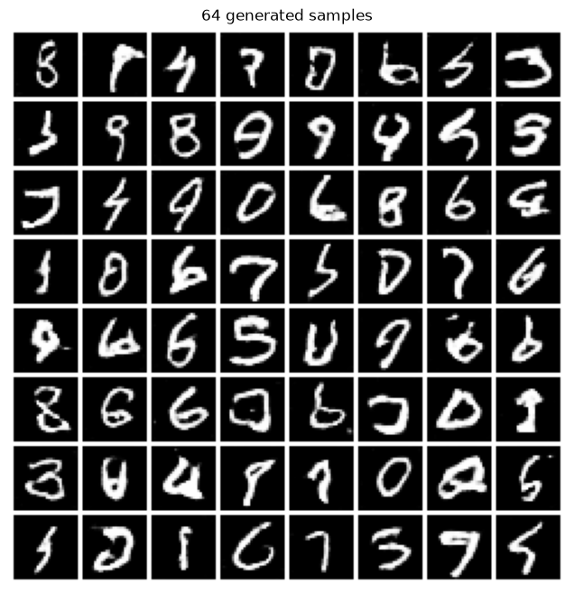
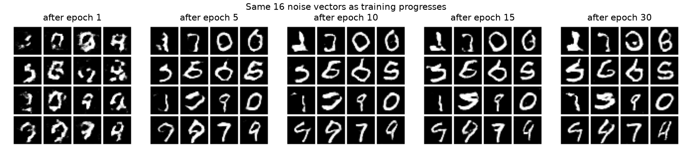
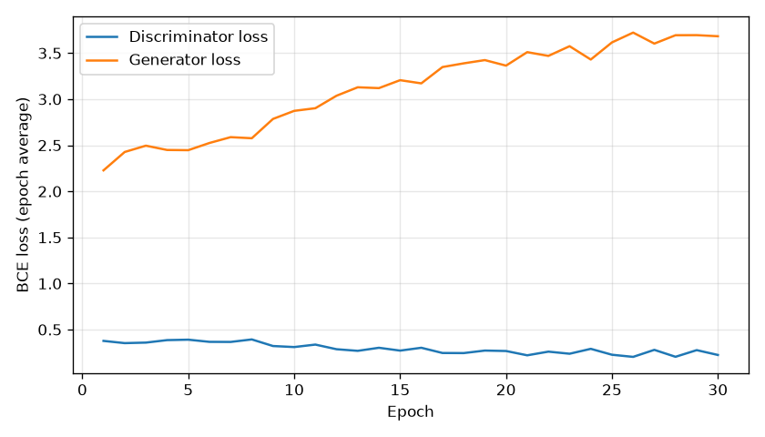
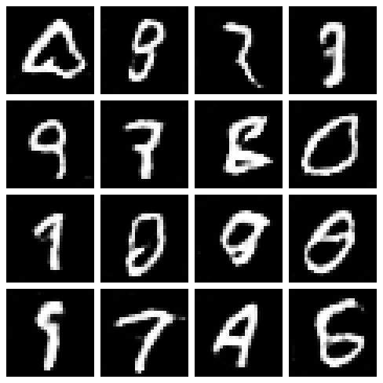

# Assignment 4 Energy Based and Diffusion Image Generation

This extends the existing Applied Generative AI API with two CIFAR-10 generators.
The submitted checkpoints each completed one epoch over all 50,000 training images.
Additional epochs were stopped to prioritize the submission deadline. Image fidelity is
limited; these are small educational models rather than pretrained image generators.

## Run the complete Docker deployment

```bash
docker build -t sps-genai-assignment4 .
docker run --rm -p 8000:80 sps-genai-assignment4
```

Open http://127.0.0.1:8000/docs. All trained checkpoints are included in `models/`;
server startup does not download CIFAR-10 or retrain models.

```bash
curl -o energy.png "http://127.0.0.1:8000/energy/generate?num_samples=4&steps=256&seed=7"
curl -o diffusion.png "http://127.0.0.1:8000/diffusion/generate?num_samples=4&steps=100&seed=7"
curl "http://127.0.0.1:8000/energy/generate/pixels?seed=7"
curl "http://127.0.0.1:8000/diffusion/generate/pixels?seed=7"
curl "http://127.0.0.1:8000/generators/info"
```

PNG endpoints return enlarged RGB image grids. Pixel endpoints return arrays in
`[sample, channel, row, column]` order, with per-image shape `[3, 32, 32]` and
values in `[0, 1]`. Requests accept 1-16 samples, diffusion accepts 2-200 steps,
and energy sampling accepts 1-512 steps. The optional seed makes requests repeatable.
Invalid query values return HTTP 422. Missing checkpoints return HTTP 503.

## Training and verification

```bash
uv sync --frozen
uv run python train_generative.py --model energy --epochs 1 --langevin-steps 30
uv run python train_generative.py --model diffusion --epochs 1
uv run python evaluate_generative.py
uv run python verify_theory.py
uv run python -m unittest discover -s tests -v
uv run python verify_api.py --url http://127.0.0.1:8000
```

Training uses all 50,000 CIFAR-10 training images at native RGB 32x32 resolution,
normalized to [-1, 1]. Evaluation uses all 10,000 test images. CIFAR-10 downloads
only when a training/evaluation command needs it. Training seed is 42, sample seed is 7.
The scripts support CPU, CUDA, or MPS when available. `--epochs` controls the number
of complete passes. `--resume` continues from an optimizer/replay checkpoint saved
under `data/` on the training machine; those large development files are not required
for inference and are excluded from the submission.

Energy training uses persistent contrastive divergence, a 1,024-image replay buffer,
5% restarts, 30 Langevin steps per batch, step size 10, noise std 0.005, Adam lr 0.0001,
and squared-energy regularization 0.1. The sampler differentiates energy with respect
to pixels and detaches each update. Weight training uses detached negative samples.

Diffusion uses a residual UNet with three down/up stages, sinusoidal timestep
embeddings (maximum period 10000), 1,000 cosine-schedule timesteps, noise-prediction
MSE, AdamW lr 0.0002, and EMA decay 0.995. Generation uses deterministic DDIM steps.
Both models use batch size 128. The UNet has 893,235 trainable parameters plus a frozen
EMA copy; the energy network has 77,793 parameters.

`helper_lib.get_model("Energy")` and `get_model("Diffusion")` create the models.
`train_energy`, `train_diffusion`, and `generate_samples` extend the reusable library.
`load_model` accepts both earlier raw state dictionaries and the new checkpoint format.

Worked answers: `docs/assignment4_theory.md`.
Actual training history, held-out metrics, generated samples, and live Docker HTTP
verification results are saved as `docs/assignment4_*` files.

Implementation and Assignment 4 explanations prepared with assistance from OpenAI Codex.
Previous assignment code and attribution follow below.

# sps_genai: Applied Generative AI (APANPS5560)

FastAPI app with a bigram text generator (Module 3), a spaCy word embedding endpoint (Assignment 1), a CNN image classifier trained on CIFAR-10 (Assignment 2) and a GAN that generates handwritten digits, trained on MNIST (Assignment 3).

## Run locally
    uv sync
    uv run fastapi dev app/main.py

## Run with Docker
    docker build -t sps-genai .
    docker run -p 8000:80 sps-genai

Then open http://127.0.0.1:8000/docs

## Endpoints
- POST /generate   body: {"start_word": "bigram", "length": 10}
- POST /embedding  body: {"word": "apple"} returns the 300-dimension spaCy vector
- POST /classify   multipart file upload (any jpg/png); returns the predicted CIFAR-10 class
- GET  /classify/classes  lists the 10 possible classes
- GET  /gan/generate?num_samples=16&seed=7  returns a PNG grid of new GAN-generated digits (1-64 samples; seed optional)
- GET  /gan/generate/pixels?num_samples=1  same, as raw 28x28 pixel values in JSON

## Assignment 2: CNN image classifier
- `app/cnn_model.py`: `AssignmentCNN`, built to the assignment's spec
  (64x64x3 input -> Conv 16 3x3 -> ReLU -> MaxPool 2x2 -> Conv 32 3x3 -> ReLU -> MaxPool 2x2 -> Flatten -> FC 100 -> ReLU -> FC 10)
- `train_cnn.py`: trains it on CIFAR-10 and saves `models/cnn_cifar10.pth`.
  CIFAR-10 images are 32x32, so they are resized to 64x64 to match the specified input size.
  Re-train with `uv run python train_cnn.py` (default 10 epochs).
- `app/image_classifier.py`: loads the saved weights; resizes any uploaded image to 64x64 and returns the class.
- `docs/assignment2_theory.md`: Part 3 answers.

Trained for 10 epochs (Adam, lr 0.001, batch 64): **69.3% accuracy on the 10,000 CIFAR-10 test images**.

Example request:

    curl -X POST http://127.0.0.1:8000/classify -F "file=@cat.png"

Example response (a cat from the CIFAR-10 test set):

    {"filename": "cat.png", "class": "cat", "class_index": 3, "confidence": 0.7511,
     "probabilities": {"airplane": 0.0014, "automobile": 0.0, "bird": 0.0341, "cat": 0.7511, "deer": 0.0498,
                       "dog": 0.0844, "frog": 0.0014, "horse": 0.0667, "ship": 0.0111, "truck": 0.0}}

You can also try it from http://127.0.0.1:8000/docs (open POST /classify, click "Try it out", choose an image).

## Assignment 3: GAN for handwritten digits (MNIST)
- `app/gan_model.py`: `Generator`, `Discriminator` and a `GAN` wrapper, built to the assignment's spec.
  - Generator: noise (100) -> Linear to 7x7x128 -> reshape -> ConvTranspose 128->64 (k4 s2 p1, 14x14) + BatchNorm + ReLU
    -> ConvTranspose 64->1 (k4 s2 p1, 28x28) + Tanh
  - Discriminator: image 1x28x28 -> Conv 1->64 (k4 s2 p1, 14x14) + LeakyReLU(0.2) -> Conv 64->128 (k4 s2 p1, 7x7)
    + BatchNorm + LeakyReLU(0.2) -> Flatten -> Linear -> Sigmoid (probability the image is real)
- `helper_lib/`: the course helper library, with the GAN added (Module 6 class activity)
  - `model.py`: `get_model(name)` for FCNN, CNN, EnhancedCNN, VAE, GAN
  - `trainer.py`: `train_model`, `train_vae`, `train_gan(model, data_loader, criterion, optimizer, device, epochs)`
  - `generator.py`: `generate_samples(model, device, num_samples)` samples the latent space and plots a grid
  - `data_loader.py`, `evaluator.py`, `utils.py`: data loaders, classifier evaluation, save/load/device helpers
- `train_gan.py`: trains the GAN on MNIST through `helper_lib` and saves `models/gan_mnist.pth`.
  Standard GAN with binary cross-entropy loss (the discriminator outputs a probability), Adam (lr 0.0002, betas 0.5/0.999), batch 128.
  Real images are scaled to [-1, 1] to match the generator's Tanh. Re-train with `uv run python train_gan.py` (default 30 epochs).
- `app/digit_generator.py`: loads the trained generator for the `/gan/generate` endpoints.
- `docs/assignment3_theory.md`: Part 3 answers.

Trained for 30 epochs on the 60,000 MNIST training images (about 6 minutes on an Apple Silicon GPU).
Final epoch averages: discriminator loss 0.22, generator loss 3.68, D(real) = 0.92, D(fake) = 0.09.

64 digits from the trained generator:



The same 16 noise vectors after epochs 1, 5, 10, 15 and 30:



Loss curves: 

Example request (open the URL in a browser, or use /docs and click "Try it out"):

    curl -o digits.png "http://127.0.0.1:8000/gan/generate?num_samples=16&seed=7"



From Python, using the helper library:

    from helper_lib import get_model, load_model, generate_samples
    gan = load_model(get_model("GAN"), "models/gan_mnist.pth")
    generate_samples(gan, device="cpu", num_samples=16)

Code developed with assistance from Claude (Anthropic).
