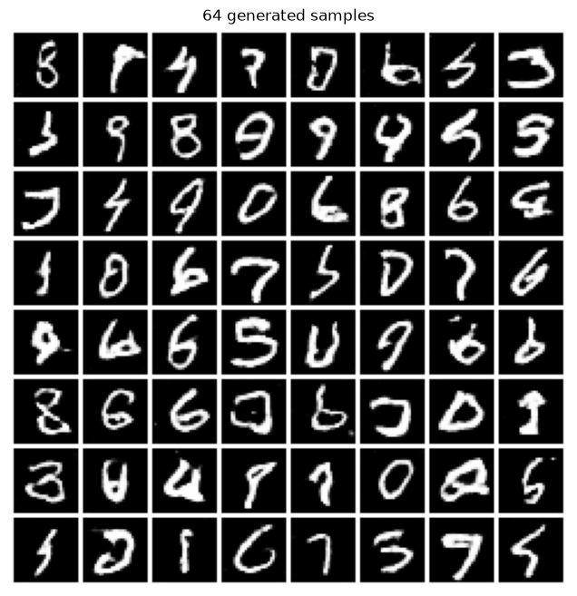
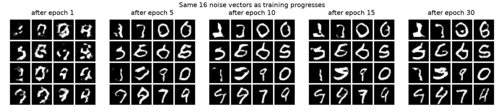
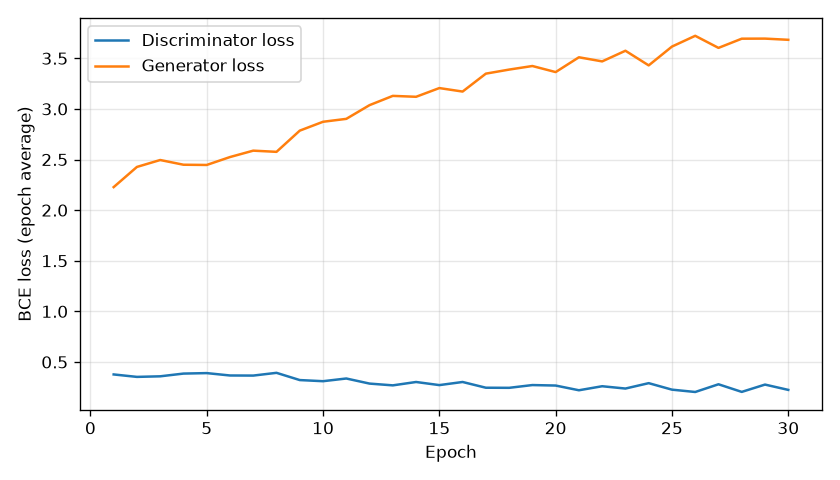
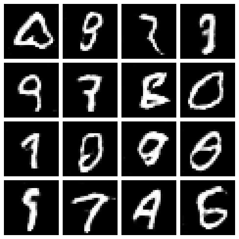

# sps_genai: Applied Generative AI (APANPS5560)

FastAPI app with a bigram text generator (Module 3), a spaCy word embedding endpoint (Assignment 1), a CNN image classifier trained on CIFAR-10 (Assignment 2) and a GAN that generates handwritten digits, trained on MNIST (Assignment 3).

## Run locally
    uv sync
    uv run fastapi dev app/main.py

## Run with Docker
    docker build -t sps-genai .
    docker run -p 8000:80 sps-genai

Then open http://127.0.0.1:8000/docs

## Endpoints
- POST /generate   body: {"start_word": "bigram", "length": 10}
- POST /embedding  body: {"word": "apple"} returns the 300-dimension spaCy vector
- POST /classify   multipart file upload (any jpg/png); returns the predicted CIFAR-10 class
- GET  /classify/classes  lists the 10 possible classes
- GET  /gan/generate?num_samples=16&seed=7  returns a PNG grid of new GAN-generated digits (1-64 samples; seed optional)
- GET  /gan/generate/pixels?num_samples=1  same, as raw 28x28 pixel values in JSON

## Assignment 2: CNN image classifier
- `app/cnn_model.py`: `AssignmentCNN`, built to the assignment's spec
  (64x64x3 input -> Conv 16 3x3 -> ReLU -> MaxPool 2x2 -> Conv 32 3x3 -> ReLU -> MaxPool 2x2 -> Flatten -> FC 100 -> ReLU -> FC 10)
- `train_cnn.py`: trains it on CIFAR-10 and saves `models/cnn_cifar10.pth`.
  CIFAR-10 images are 32x32, so they are resized to 64x64 to match the specified input size.
  Re-train with `uv run python train_cnn.py` (default 10 epochs).
- `app/image_classifier.py`: loads the saved weights; resizes any uploaded image to 64x64 and returns the class.
- `docs/assignment2_theory.md`: Part 3 answers.

Trained for 10 epochs (Adam, lr 0.001, batch 64): **69.3% accuracy on the 10,000 CIFAR-10 test images**.

Example request:

    curl -X POST http://127.0.0.1:8000/classify -F "file=@cat.png"

Example response (a cat from the CIFAR-10 test set):

    {"filename": "cat.png", "class": "cat", "class_index": 3, "confidence": 0.7511,
     "probabilities": {"airplane": 0.0014, "automobile": 0.0, "bird": 0.0341, "cat": 0.7511, "deer": 0.0498,
                       "dog": 0.0844, "frog": 0.0014, "horse": 0.0667, "ship": 0.0111, "truck": 0.0}}

You can also try it from http://127.0.0.1:8000/docs (open POST /classify, click "Try it out", choose an image).

## Assignment 3: GAN for handwritten digits (MNIST)
- `app/gan_model.py`: `Generator`, `Discriminator` and a `GAN` wrapper, built to the assignment's spec.
  - Generator: noise (100) -> Linear to 7x7x128 -> reshape -> ConvTranspose 128->64 (k4 s2 p1, 14x14) + BatchNorm + ReLU
    -> ConvTranspose 64->1 (k4 s2 p1, 28x28) + Tanh
  - Discriminator: image 1x28x28 -> Conv 1->64 (k4 s2 p1, 14x14) + LeakyReLU(0.2) -> Conv 64->128 (k4 s2 p1, 7x7)
    + BatchNorm + LeakyReLU(0.2) -> Flatten -> Linear -> Sigmoid (probability the image is real)
- `helper_lib/`: the course helper library, with the GAN added (Module 6 class activity)
  - `model.py`: `get_model(name)` for FCNN, CNN, EnhancedCNN, VAE, GAN
  - `trainer.py`: `train_model`, `train_vae`, `train_gan(model, data_loader, criterion, optimizer, device, epochs)`
  - `generator.py`: `generate_samples(model, device, num_samples)` samples the latent space and plots a grid
  - `data_loader.py`, `evaluator.py`, `utils.py`: data loaders, classifier evaluation, save/load/device helpers
- `train_gan.py`: trains the GAN on MNIST through `helper_lib` and saves `models/gan_mnist.pth`.
  Standard GAN with binary cross-entropy loss (the discriminator outputs a probability), Adam (lr 0.0002, betas 0.5/0.999), batch 128.
  Real images are scaled to [-1, 1] to match the generator's Tanh. Re-train with `uv run python train_gan.py` (default 30 epochs).
- `app/digit_generator.py`: loads the trained generator for the `/gan/generate` endpoints.
- `docs/assignment3_theory.md`: Part 3 answers.

Trained for 30 epochs on the 60,000 MNIST training images (about 6 minutes on an Apple Silicon GPU).
Final epoch averages: discriminator loss 0.22, generator loss 3.68, D(real) = 0.92, D(fake) = 0.09.

64 digits from the trained generator:

The same 16 noise vectors after epochs 1, 5, 10, 15 and 30:

Loss curves: 

Example request (open the URL in a browser, or use /docs and click "Try it out"):

    curl -o digits.png "http://127.0.0.1:8000/gan/generate?num_samples=16&seed=7"

From Python, using the helper library:

    from helper_lib import get_model, load_model, generate_samples
    gan = load_model(get_model("GAN"), "models/gan_mnist.pth")
    generate_samples(gan, device="cpu", num_samples=16)

Code developed with assistance from Claude (Anthropic).
